# AVA Impossible Mission

[](https://github.com/Harlock123/AVAImpossibleMission/actions/workflows/build.yml)

A search-and-somersault action game in the style of Dennis Caswell's 1984 Commodore 64 classic **Impossible
Mission**, built with .NET 10 and Avalonia UI. Professor Vex means to hold the world to ransom. His password
is on six punch cards, torn into pieces and hidden in the furniture of his underground complex. You have six
hours to search the rooms, put the cards back together in your pocket computer, and reach his control room.
His robots patrol every floor. A somersault takes you over them.

## Features

- **The complex:** sixteen rooms between five elevator shafts. Ride a shaft's car up and down, and step off
  to the left or right into the room at that stop. The layout is always the same: it's generated from a
  fixed seed, and every room is checked as it's made (see [Tests](#tests)).
- **Rooms:** four levels of girder floor with gaps and pits, and **lifts** that carry you a level at a time
  and stay where you leave them. Walk off an edge to drop to the floor below, but not out of the bottom of
  the room. Leaving a room and coming back sends its lifts home and puts its robots back where they began.
- **The somersault:** the button sends you four squares head over heels, high enough to clear a robot, a
  bolt or a gap.
- **Searching:** stand at a piece of furniture and hold up. Desks, bookshelves, filing cabinets, lockers,
  vending machines, consoles, jukeboxes and more each take their own time to search. Let go and you keep the
  progress you've made. What you find: a **puzzle piece**, a **snooze code**, or nothing at all.
- **Security terminals:** hold up at one to spend a snooze code and put the room's robots to sleep for twenty
  seconds. The terminal also sends every lift in the room home.
- **The robots:** **patrollers** walk their floor end to end. **Hunters** come after you, but take a moment
  to turn, lose sight of you mid-somersault, and give up once you're off their stretch of floor.
  **Shooters** stop and fire a bolt along the floor when you're in front of them. **Sentries** stand
  guard, turning now and then, and fire too. Some rooms have the **orb**, a floating mine at chest height
  over one floor, which glides after you through anything in its way. Touching any of them, or a bolt, is
  death.
- **The pocket computer** (the button in a shaft, or Tab) shows a map of the complex, with each room
  searched, partly searched or not yet visited. It also shows the pieces you hold. Lay pieces on the work
  area and turn them sideways or over until a card's three pieces show its holes the right way round. Each
  card made gives a letter of the password.
- **The clock:** six hours of mission time, running ten times faster than real time, so about 36 minutes
  of play. Each death costs ten minutes. Finish with time to spare for a bigger bonus.
- **The professor's voice:** *"Greetings, agent... Make yourself at home... permanently!"* on the title
  screen and at the start of each mission, and his cry of *"No! My plans!"* when you reach the control
  room. The voice is synthesised from scratch the way the 8-bit machines talked: a buzz and a hiss shaped
  by formant filters (`tools/speech.py`), with the words written out as phonemes. No recording or speech
  engine is involved. The long scream of a fall down a shaft is made the same way.
- **The attract mode** shows the computer agent at work. It plans its way round each room square by square,
  and tries every jump in a quick look-ahead before making it.

## Screenshots

| The title | The shaft | Searching |
|:---------:|:---------:|:---------:|
| 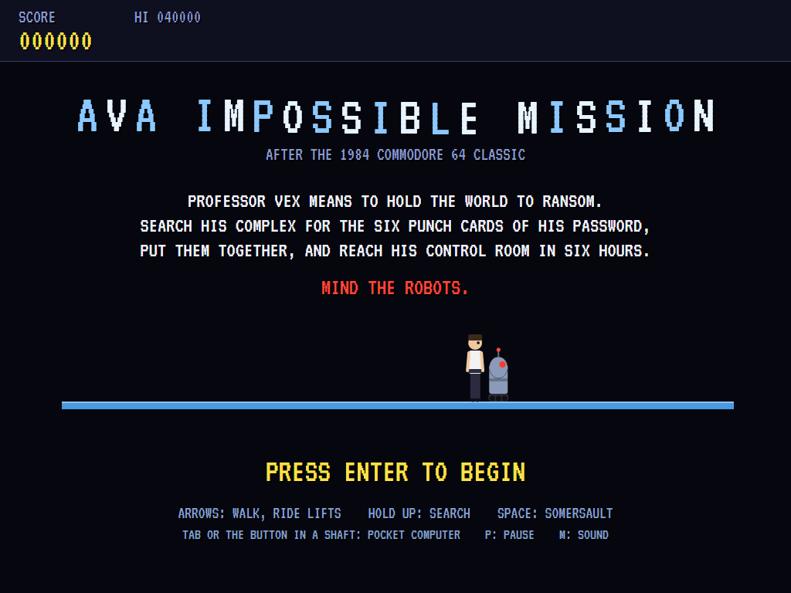 | 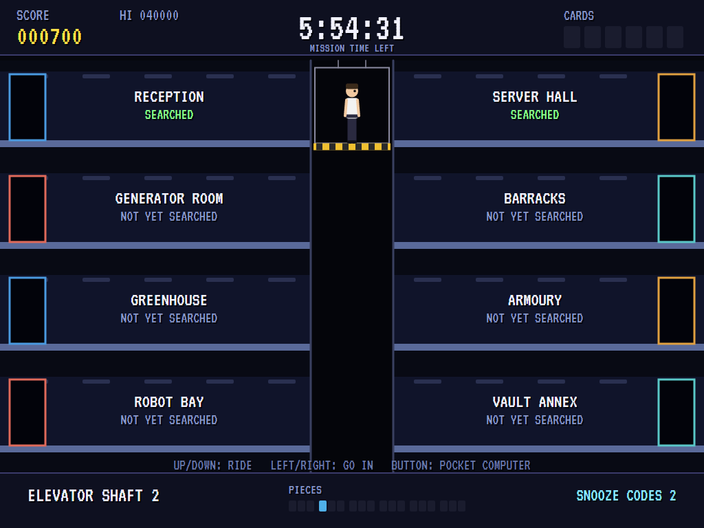 | 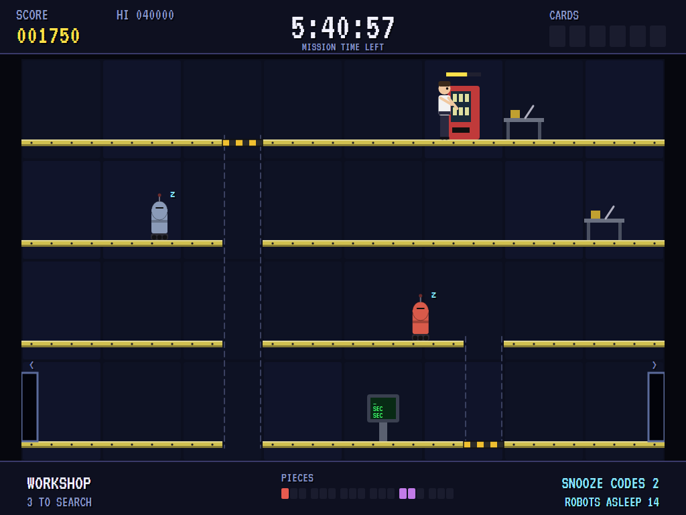 |
| Professor Vex's plan. | Riding down to the next room. | Robots snoozed at the terminal. |

| A somersault | A bolt | The orb |
|:------------:|:------:|:-------:|
| 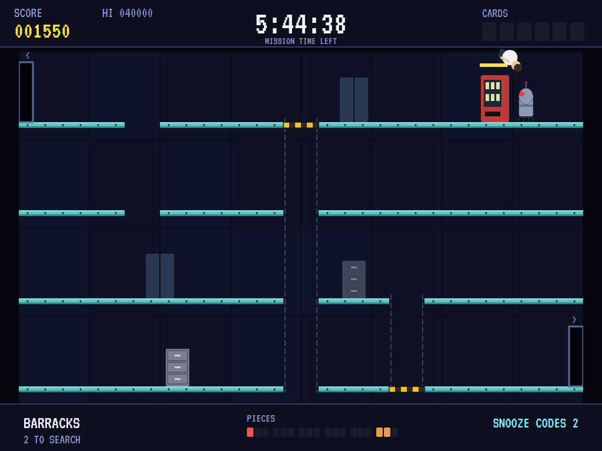 | 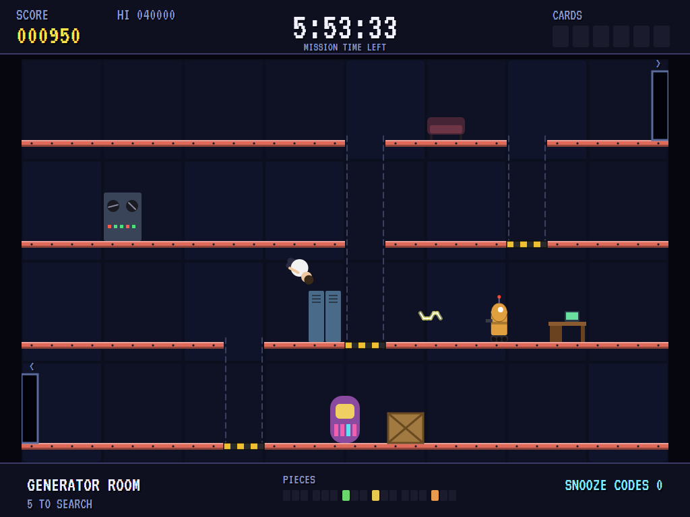 | 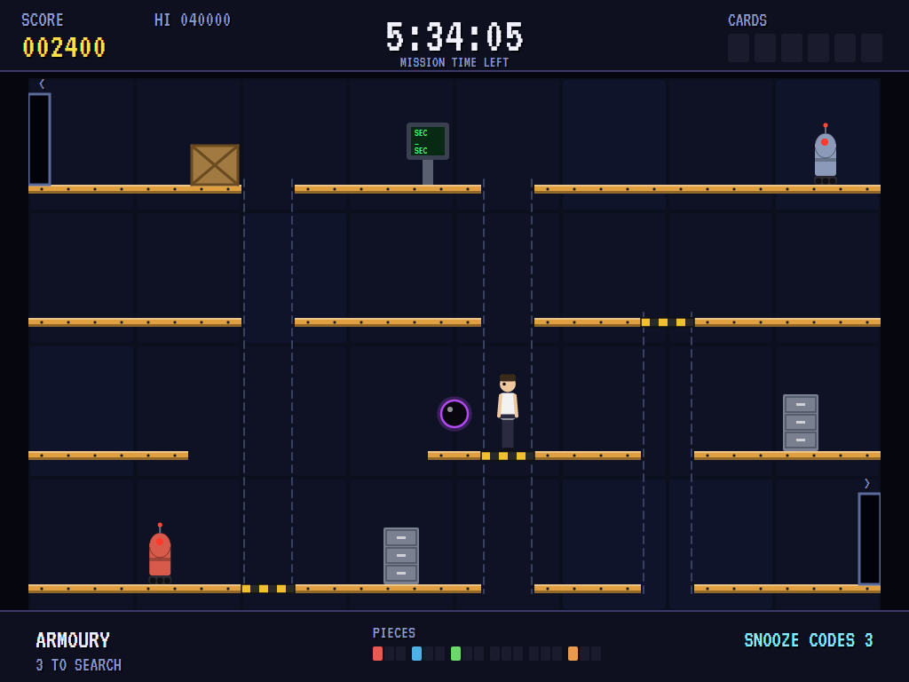 |
| Over the robot's head. | A shooter has seen you. | It glides along its floor after you. |

| A lift | A piece found | Down a shaft |
|:------:|:-------------:|:------------:|
| 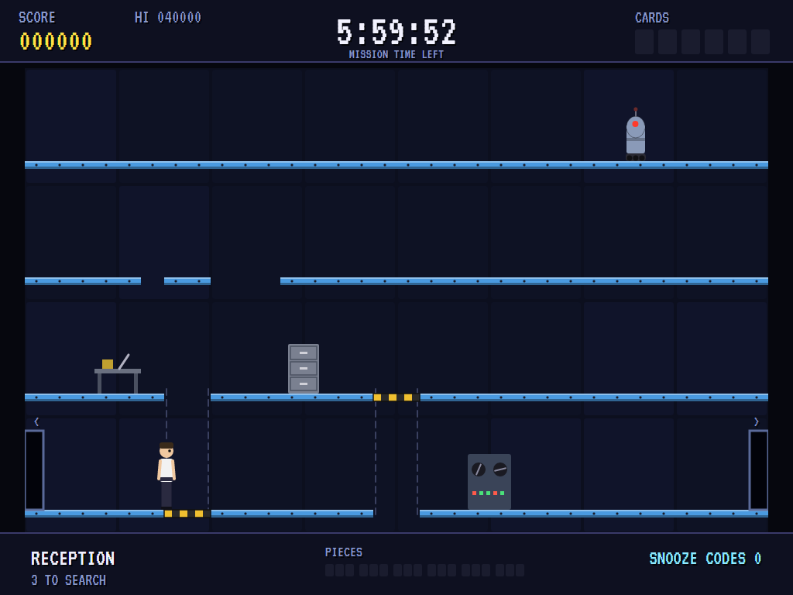 | 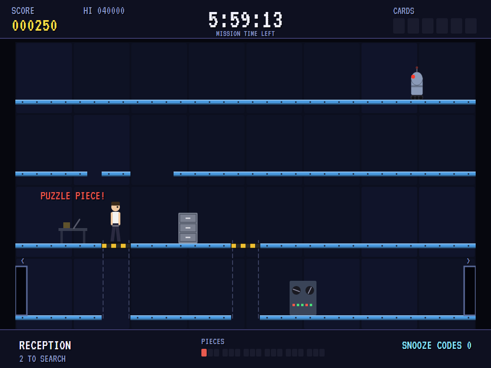 | 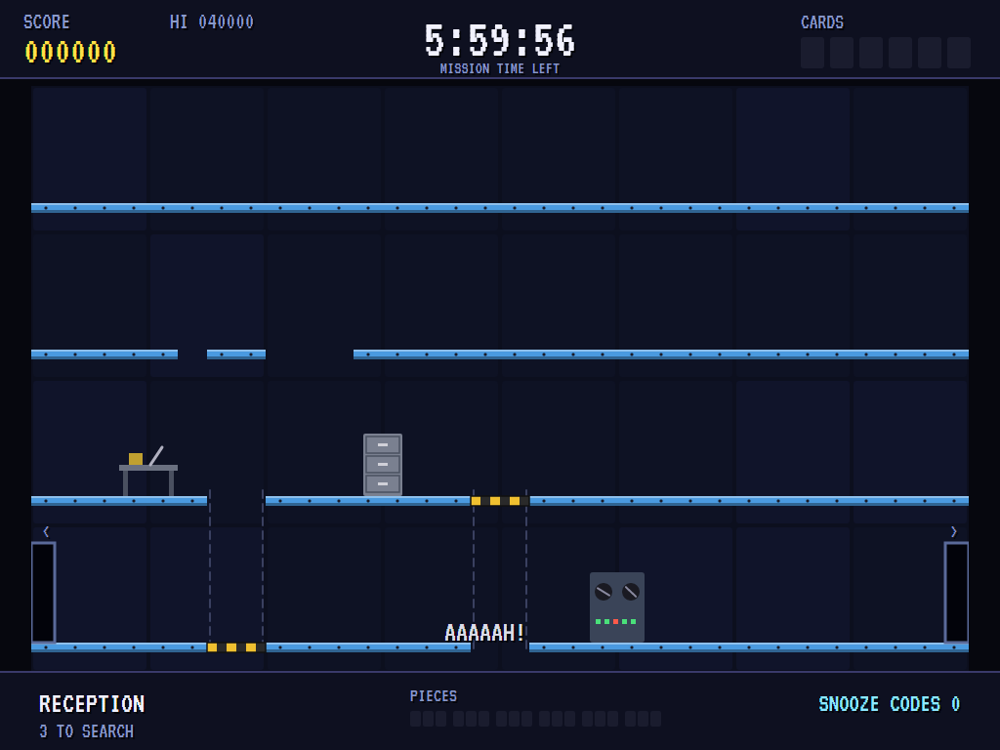 |
| Up a level. | Into the pocket computer with it. | Ten minutes lost. |

| The pocket computer | Mission accomplished | The best agents |
|:-------------------:|:--------------------:|:---------------:|
| 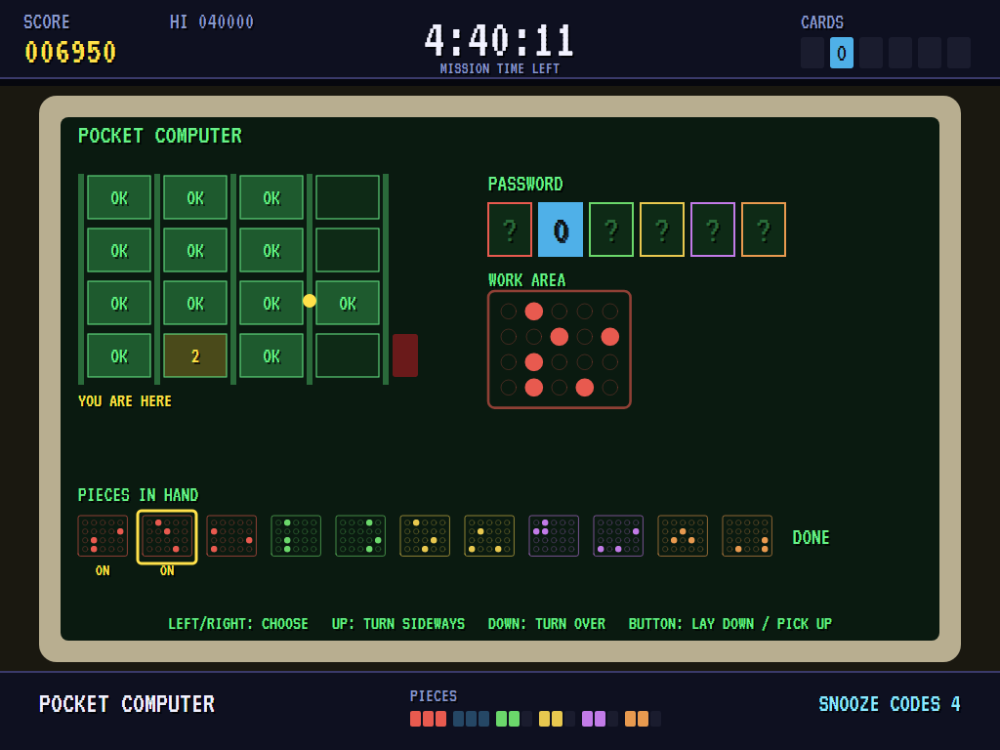 | 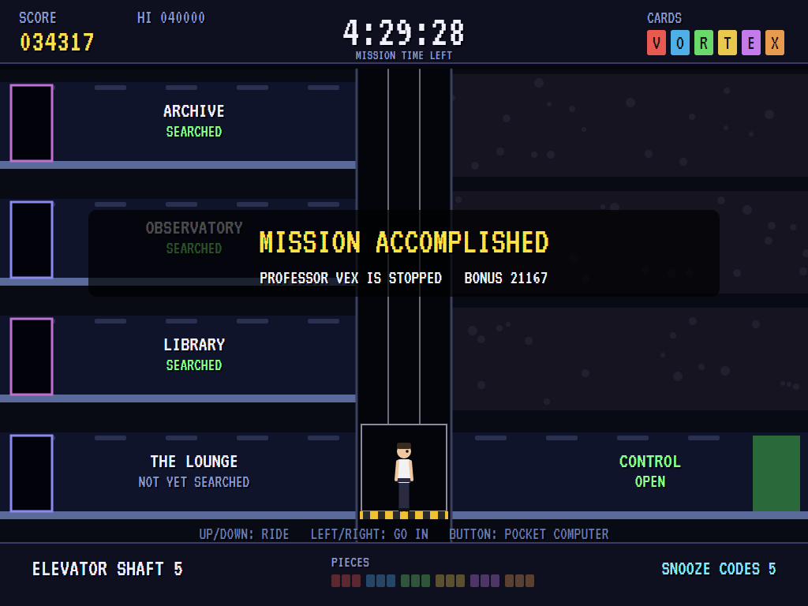 | 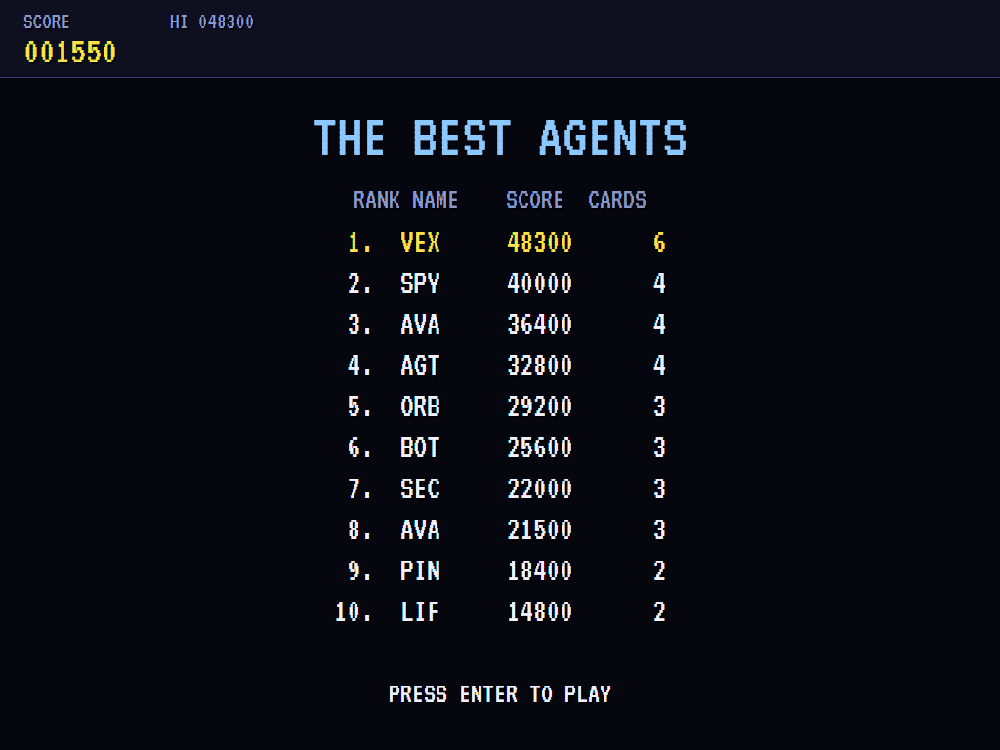 |
| Turning a card's pieces the right way round. | All six letters, and the control room. | The high-score table. |

The screenshots are made by the tests, which play the game in a real (headless) window; see
[Tests](#tests).

## Download and run

Ready-to-run builds for Windows, macOS and Linux, on both Intel/AMD and ARM, are on the
[Releases page](https://github.com/Harlock123/AVAImpossibleMission/releases/tag/latest). **Latest build** is
rebuilt on every push to `main`. Each download is one self-contained executable: no .NET install is
needed.

| Platform | Archive |
|---|---|
| Windows | `AVAImpossibleMission-win-x64.zip`, `AVAImpossibleMission-win-x86.zip`, `AVAImpossibleMission-win-arm64.zip` |
| macOS | `AVAImpossibleMission-osx-arm64.tar.gz` (Apple silicon), `AVAImpossibleMission-osx-x64.tar.gz` (Intel) |
| Linux | `AVAImpossibleMission-linux-x64.tar.gz`, `AVAImpossibleMission-linux-arm64.tar.gz`, `AVAImpossibleMission-linux-arm.tar.gz` |

```bash
tar -xzf AVAImpossibleMission-linux-x64.tar.gz     # or linux-arm64, linux-arm, osx-arm64, osx-x64
./AVAImpossibleMission
```

On Windows, unzip and run `AVAImpossibleMission.exe`. On macOS, if Gatekeeper refuses to open it, run
`xattr -d com.apple.quarantine AVAImpossibleMission` once. Run with `--no-audio` for silence.

**Sound** comes through OpenAL Soft, built in for every platform. In a virtual machine the game
detects it and uses a larger audio buffer, so the sound doesn't break up.

**Gamepads** use SDL2, which is bundled for Windows, macOS and Intel/AMD Linux. ARM Linux builds need it
installed; without it the keyboard still works:

```bash
sudo apt install libsdl2-dev            # Debian / Ubuntu / Raspberry Pi OS
sudo pacman -S --needed sdl2-compat     # Arch / Omarchy
```

## Controls

| Action | Keyboard | Gamepad |
|---|---|---|
| Start | Enter or 1 | Start |
| Walk | Left/right arrows or A/D | Left stick / D-pad |
| Ride a lift or the shaft's car | Up/down arrows or W/S | Up/down |
| Search (hold), use a terminal | Up | Up |
| Somersault | Space, Ctrl, Shift, Z or X | A or B |
| Into a room from a shaft | Left or right at a stop | Left or right |
| Pocket computer (in a shaft) | The button, or Tab | A, or Back |
| In the pocket computer | Left/right: choose a piece; up: turn it sideways; down: turn it over; the button: lay it down or pick it up (or, on DONE, leave) | The same |
| Pause | P or Esc | Start |
| Sound on/off | M | |
| Screenshot | Ctrl+S (to your Pictures folder) | |

On the high-score table, type your initials, or use up/down and Space, then Enter.

## Tests

```bash
dotnet test AVAImpossibleMission.slnx
```

The engine has no UI and runs in fixed 60 Hz steps, so it plays the same at any frame rate. The tests check:

- **The mission:** the computer agent plays whole missions to the end. It searches every room, puts all
  six cards together in the pocket computer and reaches the control room, with hours to spare.
- **The complex:** the same layout every time; sixteen rooms between five shafts. In every room, every piece
  of furniture and both doors can be reached from either door. Wherever you can get to in a room, a door can
  still be reached from there, so nobody is ever shut in (and a room that would trap you is shown to be
  refused). Robots start clear of the doorways and stay on their own stretch of floor, sentries keep away
  from the furniture, and the pieces and codes are hidden in different places, never in a terminal.
- **The puzzle:** six cards of nine holes, each looking different turned any way; three pieces of three
  holes each; only a card's three pieces, all the right way round, make it.
- **Moving about:** the shaft's car; going into rooms and out into the shaft beyond; walls away from the
  doors; dropping to a floor below; falling out of the bottom (ten minutes lost, back at the door);
  somersaults over a gap; lifts that stay where they're left and go home when the room is entered again.
- **Searching:** the time it takes, keeping progress when you let go, and what turns up. Snooze codes put
  robots to sleep (and sleeping robots do no harm), and terminals send lifts home.
- **Robots and the orb:** touching one is death; a somersault clears a robot or a bolt coming at you, but
  you can't outrun a bolt. Hunters turn after a moment and leave you alone once you're off their floor,
  shooters fire only along their own floor, and the orb follows only an agent on its floor. Robots go back
  to where they started when you come in again.
- **The pocket computer:** opened only in a shaft. Pieces are turned and laid down until a card is made,
  and pieces the wrong way round make nothing.
- **The game:** six hours on the clock, running ten times faster than real time; the control room shut
  without all six cards, and with them the win and its bonus; running out of time; the welcome on the title
  screen and at each mission's start; the demonstration and the high scores; the keys.

`tests/AVAImpossibleMission.Tests/PilotProbe.cs` reports how the computer agent gets on over five whole
missions, for tuning (`IMPOSSIBLE_PROBE=1`; `IMPOSSIBLE_PROBE=lazy` for an agent who never touches the
controls).

The screenshot tests draw the real screen in a headless window. To refresh the README's pictures:

```bash
IMPOSSIBLE_SHOTS=$PWD/Images dotnet test tests/AVAImpossibleMission.Tests --filter ScreenshotTests
```

## Building

```bash
dotnet build AVAImpossibleMission.slnx
dotnet run --project src/AVAImpossibleMission
```

Needs the .NET 10 SDK. The sounds are made by `tools/make_sounds.py` (standard-library Python):
`python3 tools/make_sounds.py` rewrites `src/AVAImpossibleMission/Sounds`, the professor's voice included.
It needs nothing but Python.

## Project structure

```
AVAImpossibleMission/
├── AVAImpossibleMission.slnx
├── src/AVAImpossibleMission/
│   ├── Engine/
│   │   ├── GameEngine.cs        # States, the title, the demonstration, the high scores
│   │   ├── GameEngine.Play.cs   # The shafts, the rooms, lifts, searching, terminals, robots, the orb, the
│   │   │                        # pocket computer, the control room; looking ahead for the computer agent
│   │   ├── Complex.cs           # Laying out the rooms, checking each one fair, and the room planner
│   │   ├── Puzzle.cs            # The punch cards and their pieces
│   │   ├── Pilot.cs             # The computer agent (the demonstration, and the tests)
│   │   ├── Entities.cs          # Furniture, lifts, robots, bolts, the orb, the agent
│   │   ├── HighScoreTable.cs, InitialsEntry.cs
│   │   ├── InputHandler.cs, ControllerManager.cs  # Keys and an SDL2 gamepad
│   │   └── SoundManager.cs      # Effects, the voice and the tunes through OpenAL
│   ├── Audio/                   # The OpenAL engine (from the author's AVABand)
│   ├── Views/                   # The drawing: rooms, furniture, robots, the shafts, the pocket computer
│   └── Sounds/                  # The synthesised effects, tunes, voice and scream
├── tests/AVAImpossibleMission.Tests/  # Mission, complex, puzzle, gameplay and screenshot tests
├── tools/make_sounds.py, tools/speech.py
└── Images/                      # Screenshots
```

## About and licence

AVA Impossible Mission © 2026 Lonnie Watson, under the [MIT License](LICENSE).

*Impossible Mission* © 1984 Epyx, designed by Dennis Caswell; the name belongs to its current owner.
AVA Impossible Mission is an independent, unofficial game in its style. Its complex, rooms, robots, puzzle,
graphics, sounds, tunes, the professor and his voice, and the code are its own; nothing is taken from the
original game's program, graphics, sound or speech. It is not affiliated with or endorsed by any rights
holder.
